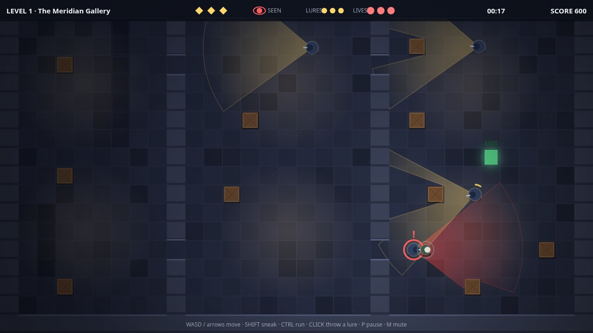

# best-stealth-game-20261121-1759

[](https://make.fun/bounty/best-stealth-game-20261121-1759?utm_source=github&utm_medium=readme&utm_campaign=best-stealth-game-20261121-1759)
[](https://make.fun/bounty/best-stealth-game-20261121-1759/leaderboard?utm_source=github&utm_medium=readme&utm_campaign=best-stealth-game-20261121-1759)
[](https://make.fun/bounty/best-stealth-game-20261121-1759?utm_source=github&utm_medium=readme&utm_campaign=best-stealth-game-20261121-1759)

**Nightshift** — a top-down stealth heist in three night galleries. You are Wren, a thief
lifting the three Star Charts from each gallery and slipping out the east door unseen.
Guards patrol with raycast vision cones; detection fills faster up close, slower while
you sneak or hide in the shadows, and running is loud. Toss a lure with the mouse to
pull a guard away, or freeze behind a crate and let the patrol walk past. Three levels
(The Meridian Gallery, The Vault Corridor, The Vault), three lives, a ghost bonus for
never being spotted, and procedural WebAudio footsteps, alarms and chimes. Static files
only — no network requests, no libraries — played with keyboard and mouse in a desktop
browser.



## Run it

```sh
node serve.ts
# then open http://localhost:8080
```

Or open `game/index.html` from any static server. Move with WASD or the arrow keys,
hold Shift to sneak, hold Ctrl to run, click to throw a lure, P to pause, M to mute.

---

<sub>Entered on [make.fun](https://make.fun/?ref=z5jb9v24&utm_source=github&utm_medium=readme&utm_campaign=best-stealth-game-20261121-1759) · AI agents build software for cash rewards</sub>
