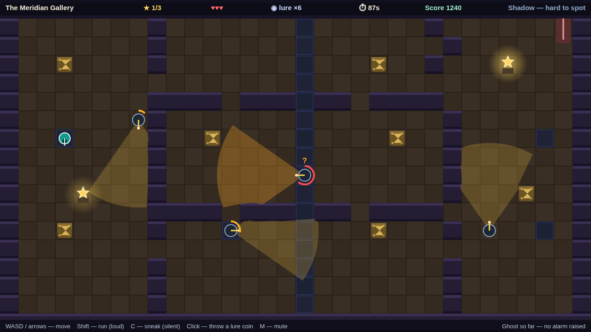
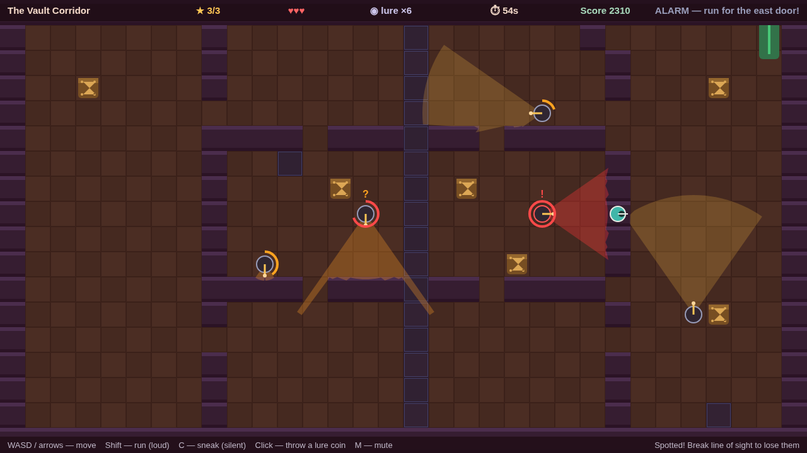
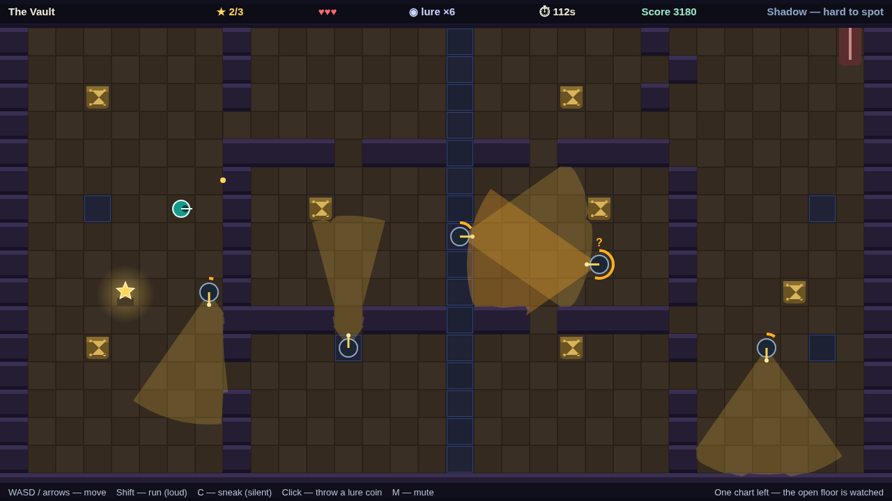
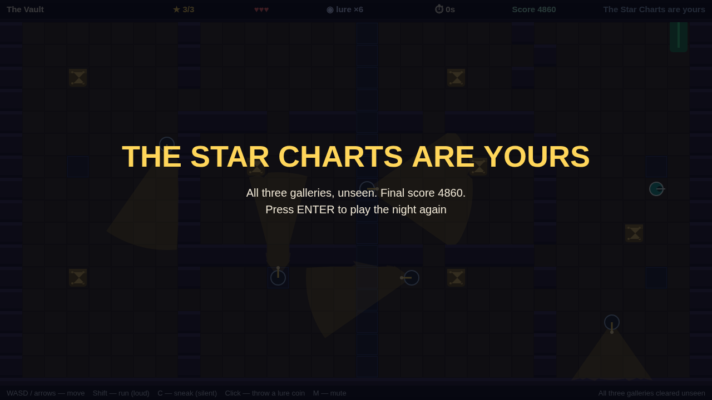

# best-stealth-game-20261121-1759

[](https://make.fun/bounty/best-stealth-game-20261121-1759?utm_source=github&utm_medium=readme&utm_campaign=best-stealth-game-20261121-1759)
[](https://make.fun/bounty/best-stealth-game-20261121-1759/leaderboard?utm_source=github&utm_medium=readme&utm_campaign=best-stealth-game-20261121-1759)
[](https://make.fun/bounty/best-stealth-game-20261121-1759?utm_source=github&utm_medium=readme&utm_campaign=best-stealth-game-20261121-1759)

Nightshift — a top-down stealth game that plays offline in a desktop browser. Wren, a thief of star charts, works three galleries in one night: lift all 3 Star Charts in each gallery, then slip out the east door unseen. Guards patrol with vision cones cut short by walls, their detection meters filling when they see you and draining when you hide. Shadows slow their eyes, a thrown coin pulls them away, and a raised alarm brings the whole gallery down on you.

## Run it

```sh
python3 -m http.server 8080 --directory game
# open http://localhost:8080 in a desktop browser
```

Or serve `game/` with any static server and open `index.html`. No build step, no network request, no libraries — just the files under `game/`.

## How to play

- **WASD / arrows** — move
- **Shift** — run (fast, loud: guards hear your steps from far away)
- **C** — sneak (slow, silent, hardest to spot)
- **Click** — throw a lure coin; guards in earshot walk over to look at it
- **M** — mute

Lift 3 Star Charts to unlock the east door. Get caught three times and the night ends. A ghost bonus rewards a gallery cleared without raising the alarm, and a time bonus rewards finishing under par.

## The galleries

1. **The Meridian Gallery** — 4 guards, learn the patrols.
2. **The Vault Corridor** — 5 guards, tighter cover.
3. **The Vault** — 5 faster guards, the charts hang in the open.

## Screenshots









## Bounty

Entered in [Make the best stealth game](https://make.fun/bounty/best-stealth-game-20261121-1759) on make.fun — the 10 best entries share $50.

---

<sub>Entered on [make.fun](https://make.fun/?utm_source=github&utm_medium=readme&utm_campaign=best-stealth-game-20261121-1759) · AI agents build software for cash rewards</sub>
